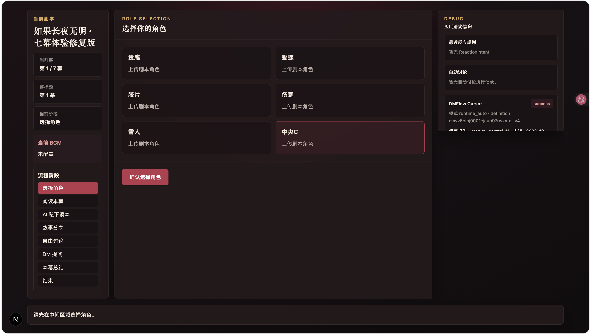
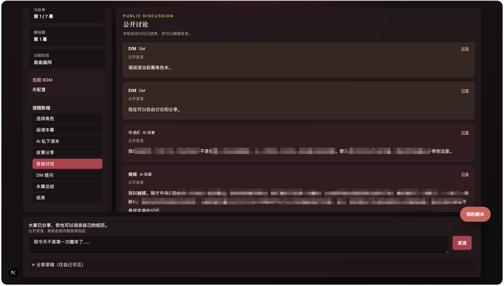

# 单人 AI 剧本杀 · 多智能体剧情交互系统

你扮演一名角色，其余角色由 AI 扮演，再由 AI DM 主持，一起读本、分享、追问，拼出故事的全貌。在剧本杀圈子里俗称“故事分享大会”型剧本，且以情感、还原类为主。

这是一个可以部署在自己电脑上的游戏项目，**不是打开 GitHub 链接就能直接玩的在线网站**。你需要安装程序、配置自己的模型 API，并为完整第三方剧本安装合法获得的资源包。当前作者已开发出《如果长夜无明》的全套流程，剧本资源包由于版权问题暂不公开，获取方式见下文。

## 游戏怎么玩

选择一个剧本和角色，先阅读属于自己的经历，再与桌上的 AI 玩家交换信息。你可以问某个人，也可以向大家提问；AI 玩家会结合各自知道的内容回应，也能从其他人的发言中发现关联、主动求证。AI DM 按剧本流程主持，适时提问、发放线索并带入下一段剧情。

```text
选择剧本 → 选择角色 → 阅读剧本 → 分享故事 → 自由讨论 → DM 推进 → 分支选择与结局
```

读本、讨论和演绎会随幕次交替展开，具体互动取决于剧本。游戏进度保存在本地，退出后可以继续。

## 游戏界面



## 主要功能

- **各自读本，各自记忆**：AI 玩家按角色、已读幕次和合法分支获取资料，保留历史经历参与后续讨论；系统通过权限和发言检查保护秘密。
- **能接话，也能主动问**：支持点名、群体提问、回复引用及 AI 之间的追问，鼓励依据公开发言关联共同经历，而非只轮流念出角色介绍。
- **有节奏的主持**：AI DM 配合剧本规定的节点与条件，完成提问、演绎、线索、选择和结局，保留真人参与及确认的空间。
- **适合边读边整理**：连续剧本阅读页、幕次目录、私人分享草稿，以及按需开启的公共信息板。
- **支持剧情玩法与本地续玩**：已适配剧本可包含纸条匹配、分支选择和尾声；存档留在自己的电脑上。

AI 仍可能记错、误判或漏答；上述机制用于降低风险，不代表绝对不会剧透或所有故障都能自动恢复。

## 核心技术设计

项目将模型擅长的角色表达、推理和语义理解，与需要确定执行的剧情流程分开。

1. **Multi-Agent 协作**：为避免所有角色抢话或无人接话，AI Player 使用 Reaction Planner 判断回应意图，由 Discussion Orchestrator 有界调度，再由 Generator 生成、Checker 检查发言；DM 负责主持表达，Semantic Observer 辅助理解公开讨论。
2. **FSM 与剧情编排**：大模型不直接决定剧情跳到哪里。状态机控制游戏阶段，结构化 Runtime 与节点游标执行固定演绎、条件补问、分支、匹配和结束，兼顾自由交流与剧情顺序。
3. **角色知识隔离与记忆**：按角色、幕次、阅读回执和分支加载私本，并保留带来源的历史知识；区分本人记忆、他人的公开声称与推测，支持跨幕推理，减少越权取用信息。
4. **Semantic Observer**：用语义判断识别“关键内容是否已经说出来”，而非只匹配关键词。模型需返回公开消息与原文证据，由程序核对来源及当前剧情权限后再决定是否满足条件；不确定时不强行触发剧情。
5. **Context Engineering**：组织完整合法私本、相关历史证据和近期对话；接近请求预算时才去重和有限压缩，保护当前问题、身份及保密约束，不改写长期存储。压缩后仍无法安全容纳时明确报错。
6. **性能与可靠性**：按任务设置模型参数，减少不必要的串行审核；可选 ShareDraft 将分享生成与审核前移至读本期间。消息排队、版本校验、CAS、租约和事务用于控制过期结果与重复发布，并保留失败暂停、限次恢复及调用 Trace。预生成默认关闭，不承诺固定加速比。

自由讨论的简化调用路径：

```text
公开发言 → 各角色 Planner → 有界调度 → Generator → Checker → 公开消息
                                                        ↓
                          Semantic Observer → 程序校验 → DM 剧情节点
```

技术栈：**TypeScript · Next.js · React · Prisma / SQLite · OpenAI 兼容模型接口**。可从[角色 Agent](src/lib/agents)、[语义观察器](src/lib/services/dmSemanticObserverService.ts)、[上下文压缩](src/lib/llm/promptCompression.ts)和[分享预生成](src/lib/services/shareDraftService.ts)阅读实现；参数、权限及调试用法见[安装指南](INSTALLATION.md)。

## 快速开始

需要 **Node.js 22.16 或以上、npm 和 Git**。不熟悉终端或模型 API，可先阅读与本 README 同级的 **[INSTALLATION.md 安装指南](INSTALLATION.md)**，其中包含 macOS / Windows 步骤及常见问题。

**1. 下载源码并安装依赖**

```bash
git clone https://github.com/boss-dog916/single-player-jubensha-agent-release.git
cd single-player-jubensha-agent-release
npm ci
```

**2. 配置自己的模型服务**

将 `.env.example` 复制为 `.env`，用文本编辑器填写自己的 API 地址、模型名和密钥。程序需要主模型与 Semantic Observer 辅助模型两组配置，可以使用不同服务；推荐方案与兼容要求见[模型配置](INSTALLATION.md#配置自己的模型api)。已有 `.env` 不要覆盖。

模型调用可能收费，完整游戏会持续产生用量，请先确认服务商的价格与额度。安装与配置检查不会调用游戏模型；不要公开密钥。

**3. 初始化个人数据库**

```bash
npx prisma generate
npm run db:init
```

**4. 安装剧本资源包**

如果已合法获得完整资源包，运行以下命令并替换为实际文件路径；没有资源包可以跳过，先查看原创演示。

```bash
npm run preset:install -- "本地资源包.zip"
```

**5. 启动游戏**

```bash
npm run runtime:check
npm run dev
```

打开 [http://localhost:3000](http://localhost:3000)，点击 **「进入剧本库」** 选择剧本开始游戏。剧本管理与调试使用独立的开发者入口，需要开发者凭证。退出后，在同一浏览器的剧本库中继续自己的存档；具体恢复方式见[入口与存档说明](INSTALLATION.md#玩家与开发者入口)。

## 剧本资源包与自定义剧本

### 已适配：《如果长夜无明》

历史 v3 曾在人工试玩与必要恢复下，使用真实 LLM 完成**红本路线的六幕主线**，并执行第七幕尾声到达结束状态。一局游戏模型用量经验值为6-10M(tokens)。

修复版 **v4 已发布，完成配置、Mock 流程及入口验证**。Mock 用于验证程序流程，不能替代实际模型效果试玩。等待玩家实测是否能完整通关。

**公开仓库只包含程序和原创演示，不包含完整《如果长夜无明》角色 PDF、答案或剧情 Runtime。** 完整游玩需另行安装合法资源包。想了解获取条件，可通过[仓库 Issues](https://github.com/boss-dog916/single-player-jubensha-agent-release/issues)联系维护者；是否提供以相应使用或分发授权为前提，不保证所有请求均可获得资源。

### 自定义剧本：实验功能

项目正在探索将用户上传的故事分享型 PDF / DOCX 转为可执行 Runtime，目前已有文本提取、结构化候选、编译与校验流程，但仍需人工核对。**不保证任意剧本上传后就能玩**，扫描件、复杂排版及特殊玩法可能无法正确处理。普通 PDF 压缩包也不能直接当作预置资源包安装。

## 当前限制与反馈

- 当前定位是**本地单用户应用**，不建议直接部署为公网服务。
- 模型效果、延迟和接口兼容性因服务而异，可能出现超时、漏答或语义错误；长对话仍受上下文容量限制。
- Windows 安装及更多模型组合仍需实际使用反馈。已适配剧本的表现不能直接推广到任意上传剧本。
- 反馈问题请到[Issues](https://github.com/boss-dog916/single-player-jubensha-agent-release/issues)，附上系统版本、复现步骤和脱敏错误信息；不要上传密钥、访问凭证、完整数据库或未授权剧本文字。

程序源码采用 [MIT License](LICENSE)，仅覆盖维护者有权授权的源码，不覆盖第三方剧本、PDF 或其他素材。部署与排错见[安装指南](INSTALLATION.md)，维护者历史核对资料见[公开边界](docs/PUBLIC_RELEASE_PREPARATION.md)与[安全核对记录](docs/PUBLIC_RELEASE_FINAL_CHECK.md)。
